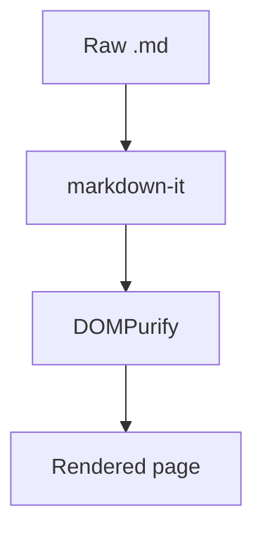

# Markdown Viewer Extension Implementation Plan

> **For agentic workers:** REQUIRED SUB-SKILL: Use superpowers:subagent-driven-development (recommended) or superpowers:executing-plans to implement this plan task-by-task. Steps use checkbox (`- [ ]`) syntax for tracking.

**Goal:** A Chrome + Firefox extension that renders local (`file://`) and remote (`http(s)://`) `.md` files in place — fast, sanitized, with GFM + highlighting + KaTeX + Mermaid, TOC sidebar, themes, raw toggle, and auto-reload.

**Architecture:** A content script matched on markdown-extension URLs verifies the tab is a raw text file, reads the already-loaded plain text, renders it through a pure `markdown-it → DOMPurify` pipeline, and replaces the body with a viewer shell (sidebar + toolbar + article). A static declarativeNetRequest ruleset strips restrictive CSP headers on markdown navigations. WXT builds one codebase into Chrome MV3 and Firefox MV3 packages.

**Tech Stack:** WXT + TypeScript, markdown-it (+ anchor/task-lists/footnote/emoji/sub/sup/deflist/@vscode/markdown-it-katex), DOMPurify, highlight.js (`lib/common`), KaTeX, Mermaid (lazy), github-markdown-css, vitest (+ jsdom, WxtVitest), Playwright, web-ext.

## Global Constraints

- Manifest V3 for **both** browsers (`manifestVersion: 3` in wxt.config.ts). Firefox `strict_min_version: "128.0"` (first version with declarativeNetRequest enabled by default), gecko id `browser-markdown@sutharjay`.
- All libraries bundled locally. No remote code, no `eval`, no inline `<script>` — Chrome Web Store and AMO both reject these.
- Every HTML string passes `DOMPurify.sanitize` before touching the DOM. No exceptions, ever.
- Permissions exactly: `storage`, `declarativeNetRequest`; host_permissions exactly `['*://*/*.md*', '*://*/*.markdown*', '*://*/*.mkd*']`.
- Node ≥ 20, npm. TypeScript strict. `any` allowed only in the documented interop shims (`lib/shims.d.ts`, katex plugin import, popup form binding).
- Unit tests: `npx vitest run`. Commit at the end of every task.
- API-drift note: this plan targets WXT ≥ 0.19. If an import path fails (`wxt/browser`, `wxt/testing`), the auto-imported globals (`browser`, `defineContentScript`, `defineBackground`, `defineUnlistedScript`) and the `#imports` module are the fallbacks — check `.wxt/types` after `npx wxt prepare`.

---

### Task 1: Scaffold WXT project, manifest, and CSP-strip ruleset

**Files:**
- Create: `package.json`, `wxt.config.ts`, `vitest.config.ts`, `tsconfig.json`, `.gitignore`
- Create: `public/rules.json` (declarativeNetRequest static ruleset)
- Create: `entrypoints/background.ts`
- Create: `lib/patterns.ts`
- Create: `lib/shims.d.ts`

**Interfaces:**
- Produces: `MARKDOWN_URL_PATTERNS: string[]` from `lib/patterns.ts` (used by the content script in Task 6). Build outputs at `.output/chrome-mv3/` and `.output/firefox-mv3/`.

- [ ] **Step 1: Initialize package.json and install dependencies**

```bash
npm init -y
npm pkg set name="browser-markdown" version="0.1.0" private=true type="module"
npm pkg set scripts.postinstall="wxt prepare" scripts.dev="wxt" scripts.dev:firefox="wxt -b firefox" scripts.build="wxt build -b chrome && wxt build -b firefox" scripts.zip="wxt zip -b chrome && wxt zip -b firefox" scripts.test="vitest run" scripts.e2e="playwright test" scripts.lint:firefox="web-ext lint --source-dir .output/firefox-mv3"
npm i -D wxt typescript vitest jsdom @playwright/test web-ext @types/markdown-it
npm i markdown-it markdown-it-anchor markdown-it-task-lists markdown-it-footnote markdown-it-emoji markdown-it-sub markdown-it-sup markdown-it-deflist @vscode/markdown-it-katex katex github-slugger dompurify highlight.js mermaid github-markdown-css
```

Expected: installs succeed; `wxt prepare` runs via postinstall and creates `.wxt/`.

- [ ] **Step 2: Write config files**

`wxt.config.ts`:

```ts
import { defineConfig } from 'wxt';

export default defineConfig({
  manifestVersion: 3,
  manifest: ({ browser }) => ({
    name: 'Markdown Viewer',
    description: 'Fast, safe markdown rendering for local and remote .md files.',
    permissions: ['storage', 'declarativeNetRequest'],
    host_permissions: ['*://*/*.md*', '*://*/*.markdown*', '*://*/*.mkd*'],
    declarative_net_request: {
      rule_resources: [{ id: 'strip-csp', enabled: true, path: 'rules.json' }],
    },
    web_accessible_resources: [
      {
        resources: ['assets/*', 'chunks/*', 'mermaid-runner.js'],
        matches: ['<all_urls>'],
      },
    ],
    ...(browser === 'firefox' && {
      browser_specific_settings: {
        gecko: { id: 'browser-markdown@sutharjay', strict_min_version: '128.0' },
      },
    }),
  }),
});
```

`vitest.config.ts`:

```ts
import { defineConfig } from 'vitest/config';
import { WxtVitest } from 'wxt/testing';

export default defineConfig({
  plugins: [WxtVitest()],
  test: {
    environment: 'jsdom',
    include: ['tests/**/*.test.ts'],
  },
});
```

`tsconfig.json`:

```json
{
  "extends": "./.wxt/tsconfig.json",
  "compilerOptions": {
    "strict": true
  }
}
```

`.gitignore`:

```
node_modules/
.output/
.wxt/
stats.html
test-results/
```

- [ ] **Step 3: Write the DNR ruleset, background entrypoint, patterns, and type shims**

`public/rules.json` — strips CSP only on main-frame markdown navigations (sites like raw.githubusercontent.com send `default-src 'none'; sandbox`, which would block our styles/fonts/images):

```json
[
  {
    "id": 1,
    "priority": 1,
    "action": {
      "type": "modifyHeaders",
      "responseHeaders": [
        { "header": "content-security-policy", "operation": "remove" },
        { "header": "content-security-policy-report-only", "operation": "remove" }
      ]
    },
    "condition": {
      "regexFilter": "\\.(md|mdown|markdown|mkd|mkdn)(\\?.*)?$",
      "resourceTypes": ["main_frame"]
    }
  }
]
```

`entrypoints/background.ts` (minimal — static DNR rules need no runtime code; this exists so the build has a background and as the future home for onInstalled logic):

```ts
export default defineBackground(() => {
  browser.runtime.onInstalled.addListener(() => {
    console.log('[markdown-viewer] installed');
  });
});
```

`lib/patterns.ts` — `.md*` also matches `.mdown`; `.mkd*` also matches `.mkdn`. False positives (e.g. `.mdx`) are rejected by the Task 3 content-type check:

```ts
export const MARKDOWN_URL_PATTERNS = [
  '*://*/*.md*',
  '*://*/*.markdown*',
  '*://*/*.mkd*',
  'file:///*.md*',
  'file:///*.markdown*',
  'file:///*.mkd*',
];
```

`lib/shims.d.ts` — untyped markdown-it plugins and vite `?inline` imports:

```ts
declare module 'markdown-it-task-lists';
declare module 'markdown-it-footnote';
declare module 'markdown-it-sub';
declare module 'markdown-it-sup';
declare module 'markdown-it-deflist';
declare module 'markdown-it-emoji' {
  export const full: any;
  export const light: any;
  export const bare: any;
}
declare module '@vscode/markdown-it-katex' {
  const plugin: any;
  export default plugin;
}
declare module '*.css?inline' {
  const css: string;
  export default css;
}
```

- [ ] **Step 4: Verify both builds succeed**

Run: `npm run build`
Expected: `.output/chrome-mv3/manifest.json` and `.output/firefox-mv3/manifest.json` exist. Chrome manifest has `declarative_net_request` and no `browser_specific_settings`; Firefox manifest has `browser_specific_settings.gecko.id === "browser-markdown@sutharjay"`. `rules.json` is present in both output dirs.

Verify: `cat .output/chrome-mv3/manifest.json` and `cat .output/firefox-mv3/manifest.json`

- [ ] **Step 5: Commit**

```bash
git add -A
git commit -m "chore: scaffold WXT project with manifest and CSP-strip ruleset"
```

---

### Task 2: Markdown rendering pipeline (`lib/renderer.ts`)

**Files:**
- Create: `lib/renderer.ts`
- Test: `tests/renderer.test.ts`

**Interfaces:**
- Produces: `renderMarkdown(source: string, options?: RenderOptions): string` — markdown in, **sanitized** HTML string out. `RenderOptions = { katex?: boolean; emoji?: boolean }`, both default `true`. Pure module: no browser extension APIs (DOMPurify needs a DOM, provided by jsdom in tests and the page at runtime). Mermaid fences become `<pre class="mermaid">…escaped source…</pre>` for the Task 8 post-processor; code fences keep `language-*` classes for the Task 7 highlighter; headings get GitHub-style slug ids for the Task 9 TOC.

- [ ] **Step 1: Write the failing tests**

`tests/renderer.test.ts`:

```ts
import { describe, it, expect } from 'vitest';
import { renderMarkdown } from '../lib/renderer';

describe('renderMarkdown — GFM', () => {
  it('renders tables', () => {
    const html = renderMarkdown('| a | b |\n| - | - |\n| 1 | 2 |');
    expect(html).toContain('<table>');
    expect(html).toContain('<td>1</td>');
  });

  it('gives headings GitHub-style anchor ids', () => {
    expect(renderMarkdown('# Hello World!')).toContain('id="hello-world"');
  });

  it('deduplicates repeated heading slugs', () => {
    const html = renderMarkdown('# Same\n\n# Same');
    expect(html).toContain('id="same"');
    expect(html).toContain('id="same-1"');
  });

  it('renders task lists as disabled checkboxes', () => {
    const html = renderMarkdown('- [x] done\n- [ ] todo');
    expect(html).toContain('type="checkbox"');
    expect(html).toContain('disabled');
  });

  it('renders strikethrough', () => {
    expect(renderMarkdown('~~gone~~')).toContain('<s>gone</s>');
  });

  it('renders footnotes', () => {
    const html = renderMarkdown('text[^1]\n\n[^1]: the note');
    expect(html).toContain('footnote');
    expect(html).toContain('the note');
  });

  it('autolinks bare URLs', () => {
    expect(renderMarkdown('see https://example.com')).toContain('href="https://example.com"');
  });
});

describe('renderMarkdown — extensions', () => {
  it('renders emoji shortcodes', () => {
    expect(renderMarkdown('ship it :rocket:')).toContain('🚀');
  });

  it('renders inline math with KaTeX', () => {
    expect(renderMarkdown('$e = mc^2$')).toContain('katex');
  });

  it('marks mermaid fences for the post-processor', () => {
    const html = renderMarkdown('```mermaid\ngraph TD; A-->B;\n```');
    expect(html).toContain('<pre class="mermaid">');
    expect(html).toContain('graph TD');
  });

  it('tags code fences with a language class', () => {
    expect(renderMarkdown('```ts\nconst x = 1;\n```')).toContain('language-ts');
  });

  it('respects the katex toggle', () => {
    expect(renderMarkdown('$x + y$', { katex: false })).not.toContain('class="katex"');
  });

  it('respects the emoji toggle', () => {
    expect(renderMarkdown(':rocket:', { emoji: false })).not.toContain('🚀');
  });
});

describe('renderMarkdown — sanitization', () => {
  it('strips script tags', () => {
    expect(renderMarkdown('<script>alert(1)</script>')).not.toContain('<script');
  });

  it('strips event handler attributes', () => {
    expect(renderMarkdown('')).not.toContain('onerror');
  });

  it('strips javascript: links', () => {
    expect(renderMarkdown('[click](javascript:alert(1))')).not.toContain('javascript:');
  });

  it('keeps benign inline HTML (GitHub compatibility)', () => {
    expect(renderMarkdown('a <b>bold</b> move')).toContain('<b>bold</b>');
  });
});
```

- [ ] **Step 2: Run tests to verify they fail**

Run: `npx vitest run tests/renderer.test.ts`
Expected: FAIL — cannot resolve `../lib/renderer`.

- [ ] **Step 3: Write the implementation**

`lib/renderer.ts`:

```ts
import MarkdownIt from 'markdown-it';
import anchor from 'markdown-it-anchor';
import taskLists from 'markdown-it-task-lists';
import footnote from 'markdown-it-footnote';
import { full as emojiPlugin } from 'markdown-it-emoji';
import sub from 'markdown-it-sub';
import sup from 'markdown-it-sup';
import deflist from 'markdown-it-deflist';
import katexModule from '@vscode/markdown-it-katex';
import GithubSlugger from 'github-slugger';
import DOMPurify from 'dompurify';

// ESM/CJS interop: the plugin may arrive as { default: fn } depending on bundler.
const katexPlugin = (katexModule as any).default ?? katexModule;

export interface RenderOptions {
  katex?: boolean;
  emoji?: boolean;
}

export function renderMarkdown(source: string, options: RenderOptions = {}): string {
  const { katex = true, emoji = true } = options;

  // Fresh instance per render so heading-slug deduplication starts clean.
  const slugger = new GithubSlugger();
  const md = new MarkdownIt({ html: true, linkify: true })
    .use(anchor, { slugify: (s: string) => slugger.slug(s) })
    .use(taskLists)
    .use(footnote)
    .use(sub)
    .use(sup)
    .use(deflist);
  if (emoji) md.use(emojiPlugin);
  if (katex) md.use(katexPlugin);

  // Mermaid fences bypass code rendering; the post-processor reads textContent.
  const defaultFence = md.renderer.rules.fence!;
  md.renderer.rules.fence = (tokens, idx, opts, env, self) => {
    const token = tokens[idx];
    if (token.info.trim() === 'mermaid') {
      return `<pre class="mermaid">${md.utils.escapeHtml(token.content)}</pre>\n`;
    }
    return defaultFence(tokens, idx, opts, env, self);
  };

  // html:true above allows raw HTML through the parser (GitHub compatibility);
  // this sanitize pass is what makes that safe. 'encoding' is for KaTeX MathML
  // <annotation> elements, which DOMPurify would otherwise strip the attr from.
  return DOMPurify.sanitize(md.render(source), { ADD_ATTR: ['encoding'] });
}
```

- [ ] **Step 4: Run tests to verify they pass**

Run: `npx vitest run tests/renderer.test.ts`
Expected: PASS (all tests). If the KaTeX or emoji import shape errors, adjust per the interop comment — the shim in `lib/shims.d.ts` covers both shapes.

- [ ] **Step 5: Commit**

```bash
git add lib/renderer.ts tests/renderer.test.ts
git commit -m "feat: markdown-it + DOMPurify rendering pipeline with GFM, KaTeX, emoji, mermaid marking"
```

---

### Task 3: Raw-markdown document detection (`lib/detect.ts`)

**Files:**
- Create: `lib/detect.ts`
- Test: `tests/detect.test.ts`

**Interfaces:**
- Produces: `isRawMarkdownDocument(contentType: string, body: HTMLElement | null): boolean` and `extractRawText(body: HTMLElement): string`. Both take plain values (not `Document`) so they're trivially testable; the content script passes `document.contentType` and `document.body`.

- [ ] **Step 1: Write the failing tests**

`tests/detect.test.ts`:

```ts
import { describe, it, expect } from 'vitest';
import { isRawMarkdownDocument, extractRawText } from '../lib/detect';

function bodyWith(html: string): HTMLElement {
  const body = document.createElement('body');
  body.innerHTML = html;
  return body;
}

describe('isRawMarkdownDocument', () => {
  it('accepts text/plain with a single <pre> (Chrome/Firefox plain-text viewer)', () => {
    expect(isRawMarkdownDocument('text/plain', bodyWith('<pre># hi</pre>'))).toBe(true);
  });

  it('accepts text/markdown', () => {
    expect(isRawMarkdownDocument('text/markdown', bodyWith('<pre># hi</pre>'))).toBe(true);
  });

  it('rejects HTML pages served at .md URLs', () => {
    expect(isRawMarkdownDocument('text/html', bodyWith('<pre># hi</pre>'))).toBe(false);
  });

  it('rejects bodies that are not a single <pre> wrapper', () => {
    expect(isRawMarkdownDocument('text/plain', bodyWith('<div>x</div><pre>y</pre>'))).toBe(false);
    expect(isRawMarkdownDocument('text/plain', bodyWith('<div># hi</div>'))).toBe(false);
  });

  it('rejects a missing body', () => {
    expect(isRawMarkdownDocument('text/plain', null)).toBe(false);
  });
});

describe('extractRawText', () => {
  it('returns the pre text content', () => {
    expect(extractRawText(bodyWith('<pre># Title\n\nbody &amp; more</pre>'))).toBe(
      '# Title\n\nbody & more',
    );
  });
});
```

- [ ] **Step 2: Run tests to verify they fail**

Run: `npx vitest run tests/detect.test.ts`
Expected: FAIL — cannot resolve `../lib/detect`.

- [ ] **Step 3: Write the implementation**

`lib/detect.ts`:

```ts
const MARKDOWN_CONTENT_TYPES = new Set(['text/plain', 'text/markdown', 'text/x-markdown']);

/**
 * True only when the tab is the browser's raw-text rendering of a file:
 * matching content type AND the body is the plain-text <pre> wrapper.
 * This is the "never break a real website" guarantee — an HTML page that
 * happens to live at a .md URL fails both checks.
 */
export function isRawMarkdownDocument(contentType: string, body: HTMLElement | null): boolean {
  if (!MARKDOWN_CONTENT_TYPES.has(contentType.toLowerCase())) return false;
  if (!body || body.childElementCount !== 1) return false;
  return body.firstElementChild!.tagName === 'PRE';
}

export function extractRawText(body: HTMLElement): string {
  return body.firstElementChild?.textContent ?? '';
}
```

- [ ] **Step 4: Run tests to verify they pass**

Run: `npx vitest run tests/detect.test.ts`
Expected: PASS.

- [ ] **Step 5: Commit**

```bash
git add lib/detect.ts tests/detect.test.ts
git commit -m "feat: raw markdown document detection"
```

---

### Task 4: Settings storage (`lib/settings.ts`)

**Files:**
- Create: `lib/settings.ts`
- Test: `tests/settings.test.ts`

**Interfaces:**
- Produces:
  - `interface Settings { enabled: boolean; theme: 'auto' | 'light' | 'dark'; enableMermaid: boolean; enableKatex: boolean; enableEmoji: boolean; autoReload: boolean; autoReloadRemote: boolean; autoReloadIntervalMs: number }`
  - `DEFAULT_SETTINGS: Settings`
  - `getSettings(): Promise<Settings>` (defaults merged over stored partials)
  - `saveSettings(s: Settings): Promise<void>`
  - `watchSettings(cb: (s: Settings) => void): void`

- [ ] **Step 1: Write the failing tests**

`tests/settings.test.ts`:

```ts
import { describe, it, expect, beforeEach } from 'vitest';
import { fakeBrowser } from 'wxt/testing';
import { getSettings, saveSettings, DEFAULT_SETTINGS } from '../lib/settings';

beforeEach(() => {
  fakeBrowser.reset();
});

describe('settings', () => {
  it('returns defaults when nothing is stored', async () => {
    expect(await getSettings()).toEqual(DEFAULT_SETTINGS);
  });

  it('round-trips saved settings', async () => {
    await saveSettings({ ...DEFAULT_SETTINGS, theme: 'dark', enableMermaid: false });
    const s = await getSettings();
    expect(s.theme).toBe('dark');
    expect(s.enableMermaid).toBe(false);
  });

  it('merges defaults into partial stored settings (forward compatibility)', async () => {
    await fakeBrowser.storage.sync.set({ settings: { theme: 'light' } });
    expect(await getSettings()).toEqual({ ...DEFAULT_SETTINGS, theme: 'light' });
  });
});
```

- [ ] **Step 2: Run tests to verify they fail**

Run: `npx vitest run tests/settings.test.ts`
Expected: FAIL — cannot resolve `../lib/settings`.

- [ ] **Step 3: Write the implementation**

`lib/settings.ts`:

```ts
import { browser } from 'wxt/browser';

export interface Settings {
  enabled: boolean;
  theme: 'auto' | 'light' | 'dark';
  enableMermaid: boolean;
  enableKatex: boolean;
  enableEmoji: boolean;
  /** Auto-reload file:// documents by polling for changes. */
  autoReload: boolean;
  /** Also poll remote http(s) documents. Off by default to avoid hammering servers. */
  autoReloadRemote: boolean;
  autoReloadIntervalMs: number;
}

export const DEFAULT_SETTINGS: Settings = {
  enabled: true,
  theme: 'auto',
  enableMermaid: true,
  enableKatex: true,
  enableEmoji: true,
  autoReload: true,
  autoReloadRemote: false,
  autoReloadIntervalMs: 1500,
};

export async function getSettings(): Promise<Settings> {
  const stored = await browser.storage.sync.get('settings');
  return { ...DEFAULT_SETTINGS, ...(stored.settings ?? {}) };
}

export async function saveSettings(settings: Settings): Promise<void> {
  await browser.storage.sync.set({ settings });
}

export function watchSettings(callback: (settings: Settings) => void): void {
  browser.storage.sync.onChanged.addListener((changes) => {
    if (changes.settings) {
      callback({ ...DEFAULT_SETTINGS, ...(changes.settings.newValue ?? {}) });
    }
  });
}
```

- [ ] **Step 4: Run tests to verify they pass**

Run: `npx vitest run tests/settings.test.ts`
Expected: PASS.

- [ ] **Step 5: Commit**

```bash
git add lib/settings.ts tests/settings.test.ts
git commit -m "feat: synced settings with defaults merge"
```

---

### Task 5: Theme module (`lib/theme.ts`)

**Files:**
- Create: `lib/theme.ts`
- Test: `tests/theme.test.ts`

**Interfaces:**
- Consumes: `Settings['theme']` shape from Task 4 (`'auto' | 'light' | 'dark'`).
- Produces: `applyTheme(choice: 'auto' | 'light' | 'dark'): void` — swaps a `<style id="mdv-theme-css">` element between bundled light/dark GitHub + highlight.js CSS and stamps `document.documentElement.dataset.mdvTheme = 'light' | 'dark'` (which viewer.css and the Mermaid runner key off).
- Note: these four stylesheets are **color-only** (no `url()` references), so injecting them as inline `<style>` text is safe. KaTeX CSS references fonts and must NOT go through this path — it is imported as a real content-script stylesheet in Task 6 so font URLs resolve to the extension origin.

- [ ] **Step 1: Write the failing tests**

`tests/theme.test.ts`:

```ts
import { describe, it, expect, beforeEach } from 'vitest';
import { applyTheme } from '../lib/theme';

beforeEach(() => {
  document.getElementById('mdv-theme-css')?.remove();
  delete document.documentElement.dataset.mdvTheme;
});

describe('applyTheme', () => {
  it('injects dark stylesheet and stamps the html element', () => {
    applyTheme('dark');
    expect(document.documentElement.dataset.mdvTheme).toBe('dark');
    expect(document.getElementById('mdv-theme-css')?.textContent).toContain('.markdown-body');
  });

  it('switches back to light, reusing the same style element', () => {
    applyTheme('dark');
    applyTheme('light');
    expect(document.documentElement.dataset.mdvTheme).toBe('light');
    expect(document.querySelectorAll('#mdv-theme-css')).toHaveLength(1);
  });

  it('auto resolves to light when matchMedia is unavailable (jsdom)', () => {
    applyTheme('auto');
    expect(document.documentElement.dataset.mdvTheme).toBe('light');
  });
});
```

- [ ] **Step 2: Run tests to verify they fail**

Run: `npx vitest run tests/theme.test.ts`
Expected: FAIL — cannot resolve `../lib/theme`.

- [ ] **Step 3: Write the implementation**

`lib/theme.ts`:

```ts
import lightMd from 'github-markdown-css/github-markdown-light.css?inline';
import darkMd from 'github-markdown-css/github-markdown-dark.css?inline';
import lightHljs from 'highlight.js/styles/github.css?inline';
import darkHljs from 'highlight.js/styles/github-dark.css?inline';

export type ThemeChoice = 'auto' | 'light' | 'dark';

export function applyTheme(choice: ThemeChoice): void {
  const prefersDark =
    typeof matchMedia !== 'undefined' && matchMedia('(prefers-color-scheme: dark)').matches;
  const dark = choice === 'dark' || (choice === 'auto' && prefersDark);

  let el = document.getElementById('mdv-theme-css') as HTMLStyleElement | null;
  if (!el) {
    el = document.createElement('style');
    el.id = 'mdv-theme-css';
    document.head.appendChild(el);
  }
  el.textContent = (dark ? darkMd : lightMd) + '\n' + (dark ? darkHljs : lightHljs);
  document.documentElement.dataset.mdvTheme = dark ? 'dark' : 'light';
}
```

- [ ] **Step 4: Run tests to verify they pass**

Run: `npx vitest run tests/theme.test.ts`
Expected: PASS.

- [ ] **Step 5: Commit**

```bash
git add lib/theme.ts tests/theme.test.ts
git commit -m "feat: light/dark/auto theme injection"
```

---

### Task 6: Content script viewer MVP

**Files:**
- Create: `entrypoints/content/index.ts`
- Create: `entrypoints/content/viewer.ts`
- Create: `entrypoints/content/viewer.css`
- Create: `tests/fixtures/kitchen-sink.md`

**Interfaces:**
- Consumes: `MARKDOWN_URL_PATTERNS` (Task 1), `isRawMarkdownDocument`/`extractRawText` (Task 3), `renderMarkdown` (Task 2), `getSettings`/`Settings` (Task 4), `applyTheme` (Task 5).
- Produces: `initViewer(rawText: string, settings: Settings): void` and internal `ViewerShell { root, sidebar, toolbar, article, rawPre }` + `updateContent(shell, rawText, settings)` in `viewer.ts`. Tasks 7–11 extend `updateContent`/`initViewer` — this task establishes their final shape with clearly marked extension points.

- [ ] **Step 1: Write the content script entry**

`entrypoints/content/index.ts`:

```ts
import { MARKDOWN_URL_PATTERNS } from '@/lib/patterns';
import { isRawMarkdownDocument, extractRawText } from '@/lib/detect';
import { getSettings } from '@/lib/settings';
import { initViewer } from './viewer';
import './viewer.css';
// Real stylesheet import (not ?inline): KaTeX CSS references fonts, which must
// resolve against the extension origin via the manifest css list + WAR.
import 'katex/dist/katex.min.css';

export default defineContentScript({
  matches: MARKDOWN_URL_PATTERNS,
  runAt: 'document_idle',
  async main() {
    if (!isRawMarkdownDocument(document.contentType, document.body)) return;
    const settings = await getSettings();
    if (!settings.enabled) return;
    initViewer(extractRawText(document.body), settings);
  },
});
```

- [ ] **Step 2: Write the viewer**

`entrypoints/content/viewer.ts`:

```ts
import { renderMarkdown } from '@/lib/renderer';
import { applyTheme } from '@/lib/theme';
import type { Settings } from '@/lib/settings';
import { watchSettings } from '@/lib/settings';

export interface ViewerShell {
  root: HTMLElement;
  sidebar: HTMLElement;
  toolbar: HTMLElement;
  article: HTMLElement;
  rawPre: HTMLPreElement;
}

export function initViewer(rawText: string, settings: Settings): void {
  const shell = buildShell(rawText);
  document.body.replaceChildren(shell.root);
  applyTheme(settings.theme);
  matchMedia('(prefers-color-scheme: dark)').addEventListener('change', () => {
    if (settings.theme === 'auto') applyTheme('auto');
  });
  void updateContent(shell, rawText, settings);
  // Task 10 wires the toolbar here.
  // Task 11 starts the auto-reload watcher here.
  watchSettings((s) => {
    settings.theme = s.theme;
    applyTheme(s.theme);
  });
}

export async function updateContent(
  shell: ViewerShell,
  rawText: string,
  settings: Settings,
): Promise<void> {
  shell.article.innerHTML = renderMarkdown(rawText, {
    katex: settings.enableKatex,
    emoji: settings.enableEmoji,
  });
  const firstHeading = shell.article.querySelector('h1, h2');
  document.title =
    firstHeading?.textContent?.trim() || location.pathname.split('/').pop() || 'Markdown';
  if (location.hash) {
    document
      .getElementById(decodeURIComponent(location.hash.slice(1)))
      ?.scrollIntoView();
  }
  // Task 7 highlights code blocks here.
  // Task 8 renders mermaid diagrams here.
  // Task 9 rebuilds the TOC here.
}

function buildShell(rawText: string): ViewerShell {
  const root = document.createElement('div');
  root.id = 'mdv-root';
  const sidebar = document.createElement('aside');
  sidebar.id = 'mdv-sidebar';
  const toolbar = document.createElement('div');
  toolbar.id = 'mdv-toolbar';
  const article = document.createElement('main');
  article.id = 'mdv-content';
  article.classList.add('markdown-body');
  const rawPre = document.createElement('pre');
  rawPre.id = 'mdv-raw';
  rawPre.textContent = rawText;
  rawPre.hidden = true;
  root.append(sidebar, toolbar, article, rawPre);
  return { root, sidebar, toolbar, article, rawPre };
}
```

- [ ] **Step 3: Write the viewer stylesheet**

`entrypoints/content/viewer.css`:

```css
:root {
  color-scheme: light;
}
html[data-mdv-theme='dark'] {
  color-scheme: dark;
}
body {
  margin: 0;
}
#mdv-root {
  --mdv-bg: #ffffff;
  --mdv-border: #d0d7de;
  --mdv-muted: #57606a;
  display: flex;
  min-height: 100vh;
  background: var(--mdv-bg);
}
html[data-mdv-theme='dark'] #mdv-root {
  --mdv-bg: #0d1117;
  --mdv-border: #30363d;
  --mdv-muted: #8b949e;
}
#mdv-sidebar {
  position: sticky;
  top: 0;
  align-self: flex-start;
  width: 260px;
  max-height: 100vh;
  overflow-y: auto;
  flex-shrink: 0;
  padding: 16px 8px;
  border-right: 1px solid var(--mdv-border);
  font: 13px/1.5 -apple-system, BlinkMacSystemFont, 'Segoe UI', sans-serif;
}
#mdv-root[data-sidebar-collapsed] #mdv-sidebar {
  display: none;
}
.mdv-toc a {
  display: block;
  padding: 3px 8px;
  border-radius: 6px;
  color: var(--mdv-muted);
  text-decoration: none;
  overflow: hidden;
  text-overflow: ellipsis;
  white-space: nowrap;
}
.mdv-toc a:hover {
  background: rgba(128, 128, 128, 0.15);
}
.mdv-toc a.active {
  color: #2f81f7;
  font-weight: 600;
}
.mdv-toc a[data-level='2'] {
  padding-left: 20px;
}
.mdv-toc a[data-level='3'] {
  padding-left: 32px;
}
.mdv-toc a[data-level='4'],
.mdv-toc a[data-level='5'],
.mdv-toc a[data-level='6'] {
  padding-left: 44px;
}
#mdv-content {
  flex: 1;
  min-width: 0;
  max-width: 920px;
  margin: 0 auto;
  padding: 32px 48px 96px;
  box-sizing: border-box;
}
#mdv-toolbar {
  position: fixed;
  top: 12px;
  right: 16px;
  display: flex;
  gap: 6px;
  z-index: 10;
}
.mdv-btn {
  border: 1px solid var(--mdv-border);
  background: var(--mdv-bg);
  color: var(--mdv-muted);
  border-radius: 6px;
  padding: 4px 10px;
  font-size: 13px;
  cursor: pointer;
}
.mdv-btn:hover {
  filter: brightness(0.95);
}
#mdv-raw {
  flex: 1;
  padding: 24px;
  font: 13px/1.5 ui-monospace, SFMono-Regular, Menlo, monospace;
  white-space: pre-wrap;
  color: var(--mdv-muted);
}
@media print {
  #mdv-sidebar,
  #mdv-toolbar {
    display: none;
  }
}
```

- [ ] **Step 4: Write the kitchen-sink fixture**

`tests/fixtures/kitchen-sink.md`:

````markdown
# Kitchen Sink

Every feature in one file. :rocket:

## Text

**Bold**, *italic*, ~~strikethrough~~, `inline code`, H~2~O, x^2^, and a bare link: https://example.com

## Table

| Feature | Status |
| ------- | ------ |
| Tables  | ✅     |
| Math    | ✅     |

## Task list

- [x] Render markdown
- [ ] Take over the world

## Code

```ts
export function greet(name: string): string {
  return `Hello, ${name}!`;
}
```

## Math

Inline $e = mc^2$ and block:

$$
\int_0^\infty e^{-x^2} \, dx = \frac{\sqrt{\pi}}{2}
$$

## Mermaid



## Footnote

Markdown viewers are great.[^1]

[^1]: Citation needed.

## Definition list

Term
: Definition of the term.
````

- [ ] **Step 5: Build and verify manually in Chrome**

Run: `npm run build`
Expected: build succeeds; `.output/chrome-mv3/` contains the content script and two CSS files in the manifest `content_scripts[0].css`.

Manual verification:
1. Open `chrome://extensions`, enable Developer mode, "Load unpacked" → select `.output/chrome-mv3`.
2. On the extension's Details page, enable **Allow access to file URLs**.
3. Open `tests/fixtures/kitchen-sink.md` as a file URL (`file:///Users/jay/root/extension/browser-markdown/tests/fixtures/kitchen-sink.md`).
4. Expected: rendered headings/table/task list (code, math rendered via KaTeX; mermaid block shows raw text for now — Tasks 7–8 finish those). Title bar shows "Kitchen Sink".
5. Open `https://raw.githubusercontent.com/microsoft/vscode/main/README.md`. Expected: rendered (CSP stripped by the DNR rule); check DevTools console for CSP violation errors — there should be none.

- [ ] **Step 6: Verify manually in Firefox**

Run: `npm run dev:firefox` (or load `.output/firefox-mv3` via `about:debugging#/runtime/this-firefox` → "Load Temporary Add-on" → select its `manifest.json`).
Note: Firefox MV3 does not grant host permissions automatically — open the extension's Permissions panel (puzzle-piece icon → Manage Extension → Permissions) and allow access to all listed sites.
Expected: same rendering for both the file:// fixture and the raw.githubusercontent.com URL.

- [ ] **Step 7: Commit**

```bash
git add entrypoints/content tests/fixtures/kitchen-sink.md
git commit -m "feat: in-place viewer content script with shell, theming, and fixture"
```

---

### Task 7: Lazy code highlighting (`lib/highlight.ts`)

**Files:**
- Create: `lib/highlight.ts`
- Modify: `entrypoints/content/viewer.ts` (the `// Task 7` extension point)
- Test: `tests/highlight.test.ts`

**Interfaces:**
- Consumes: rendered article DOM containing `<pre><code class="language-*">` from Task 2.
- Produces: `highlightCodeBlocks(root: ParentNode, schedule?: (cb: () => void) => void): void`. Default scheduler is `requestIdleCallback` (fallback `setTimeout 0`) so multi-MB documents never jank; tests inject a synchronous scheduler.

- [ ] **Step 1: Write the failing test**

`tests/highlight.test.ts`:

```ts
import { describe, it, expect } from 'vitest';
import { highlightCodeBlocks } from '../lib/highlight';

const sync = (cb: () => void) => cb();

describe('highlightCodeBlocks', () => {
  it('highlights fenced code blocks in place', () => {
    const root = document.createElement('div');
    root.innerHTML = '<pre><code class="language-ts">const x: number = 1;</code></pre>';
    highlightCodeBlocks(root, sync);
    const code = root.querySelector('code')!;
    expect(code.classList.contains('hljs')).toBe(true);
    expect(code.querySelector('.hljs-keyword')).not.toBeNull();
  });

  it('auto-detects language for unlabelled blocks', () => {
    const root = document.createElement('div');
    root.innerHTML = '<pre><code>function f() { return 42; }</code></pre>';
    highlightCodeBlocks(root, sync);
    expect(root.querySelector('code')!.classList.contains('hljs')).toBe(true);
  });

  it('skips mermaid blocks', () => {
    const root = document.createElement('div');
    root.innerHTML = '<pre class="mermaid">graph TD; A-->B;</pre>';
    highlightCodeBlocks(root, sync);
    expect(root.querySelector('.hljs')).toBeNull();
  });
});
```

- [ ] **Step 2: Run test to verify it fails**

Run: `npx vitest run tests/highlight.test.ts`
Expected: FAIL — cannot resolve `../lib/highlight`.

- [ ] **Step 3: Write the implementation**

`lib/highlight.ts`:

```ts
// lib/common = ~40 popular languages (~half the bundle of the full build).
import hljs from 'highlight.js/lib/common';

type Scheduler = (cb: () => void) => void;

const idleScheduler: Scheduler = (cb) =>
  typeof requestIdleCallback === 'function' ? requestIdleCallback(() => cb()) : setTimeout(cb, 0);

export function highlightCodeBlocks(root: ParentNode, schedule: Scheduler = idleScheduler): void {
  for (const block of root.querySelectorAll<HTMLElement>('pre > code')) {
    if (block.parentElement?.classList.contains('mermaid')) continue;
    schedule(() => hljs.highlightElement(block));
  }
}
```

- [ ] **Step 4: Run test to verify it passes**

Run: `npx vitest run tests/highlight.test.ts`
Expected: PASS.

- [ ] **Step 5: Wire into the viewer**

In `entrypoints/content/viewer.ts`, add the import and replace the `// Task 7 highlights code blocks here.` comment:

```ts
import { highlightCodeBlocks } from '@/lib/highlight';
```

```ts
  highlightCodeBlocks(shell.article);
```

- [ ] **Step 6: Verify full suite and build, then commit**

Run: `npx vitest run && npm run build`
Expected: all tests PASS; build succeeds. Reload the unpacked extension and confirm the fixture's TypeScript block is colorized.

```bash
git add lib/highlight.ts tests/highlight.test.ts entrypoints/content/viewer.ts
git commit -m "feat: idle-scheduled code highlighting with highlight.js common languages"
```

---

### Task 8: Lazy Mermaid rendering

**Files:**
- Create: `entrypoints/mermaid-runner.ts`
- Modify: `entrypoints/content/viewer.ts` (the `// Task 8` extension point)

**Interfaces:**
- Consumes: `<pre class="mermaid">` blocks (Task 2), `data-mdv-theme` stamp (Task 5), `settings.enableMermaid` (Task 4).
- Produces: an unlisted script bundle `mermaid-runner.js` (WAR-exposed, Task 1) that defines `window.__mdvRenderMermaid: () => Promise<void>`. The viewer dynamic-imports it only when mermaid blocks exist — Mermaid's ~1.5MB never loads on ordinary documents.

- [ ] **Step 1: Write the mermaid runner entrypoint**

`entrypoints/mermaid-runner.ts`:

```ts
import mermaid from 'mermaid';

declare global {
  interface Window {
    __mdvRenderMermaid?: () => Promise<void>;
  }
}

export default defineUnlistedScript(() => {
  window.__mdvRenderMermaid = async () => {
    const dark = document.documentElement.dataset.mdvTheme === 'dark';
    mermaid.initialize({
      startOnLoad: false,
      theme: dark ? 'dark' : 'default',
      securityLevel: 'strict',
    });
    // mermaid.run marks rendered nodes with data-processed, so re-runs after
    // auto-reload only touch new blocks.
    await mermaid.run({ querySelector: 'pre.mermaid:not([data-processed])' });
  };
});
```

- [ ] **Step 2: Wire into the viewer**

In `entrypoints/content/viewer.ts`, replace the `// Task 8 renders mermaid diagrams here.` comment with a call, and add the function:

```ts
  await renderMermaidDiagrams(shell.article, settings);
```

```ts
declare global {
  interface Window {
    __mdvRenderMermaid?: () => Promise<void>;
  }
}

async function renderMermaidDiagrams(article: HTMLElement, settings: Settings): Promise<void> {
  if (!settings.enableMermaid) return;
  if (!article.querySelector('pre.mermaid')) return;
  try {
    if (!window.__mdvRenderMermaid) {
      // Loaded on demand from the extension bundle; requires the WAR entry from Task 1.
      await import(/* @vite-ignore */ browser.runtime.getURL('/mermaid-runner.js'));
    }
    await window.__mdvRenderMermaid?.();
  } catch (err) {
    // Degrade, never break: the escaped diagram source stays visible.
    console.warn('[markdown-viewer] mermaid rendering failed:', err);
  }
}
```

- [ ] **Step 3: Build and verify the bundle layout**

Run: `npm run build && ls .output/chrome-mv3`
Expected: `mermaid-runner.js` exists in the output root (plus a `chunks/` dir). If WXT emits it elsewhere, adjust the WAR `resources` in `wxt.config.ts` and the `getURL` path to match the actual location, and re-verify.

- [ ] **Step 4: Manual verification**

Reload the unpacked extension; open the kitchen-sink fixture.
Expected: the mermaid block renders as an SVG flowchart. In DevTools Network tab, `mermaid-runner.js` loads only on pages containing mermaid blocks (open a mermaid-free .md to confirm it does not load). A malformed diagram (edit fixture to `graph TD; A--`) shows Mermaid's inline error block, not a broken page.

- [ ] **Step 5: Run full suite and commit**

Run: `npx vitest run`
Expected: PASS.

```bash
git add entrypoints/mermaid-runner.ts entrypoints/content/viewer.ts
git commit -m "feat: lazy-loaded mermaid diagram rendering"
```

---

### Task 9: TOC sidebar with scrollspy (`lib/toc.ts`)

**Files:**
- Create: `lib/toc.ts`
- Modify: `entrypoints/content/viewer.ts` (the `// Task 9` extension point)
- Test: `tests/toc.test.ts`

**Interfaces:**
- Consumes: heading ids from Task 2's anchor plugin.
- Produces:
  - `interface TocEntry { id: string; text: string; level: number }`
  - `collectHeadings(root: ParentNode): TocEntry[]`
  - `renderTocList(entries: TocEntry[]): HTMLElement` — a `<nav class="mdv-toc">` of `<a href="#id" data-level data-target>` links (styled by Task 6's CSS)
  - `initScrollSpy(article: HTMLElement, toc: HTMLElement): () => void` — IntersectionObserver marking the active link; returns a disconnect function.

- [ ] **Step 1: Write the failing tests**

`tests/toc.test.ts`:

```ts
import { describe, it, expect } from 'vitest';
import { collectHeadings, renderTocList } from '../lib/toc';

function articleWith(html: string): HTMLElement {
  const el = document.createElement('main');
  el.innerHTML = html;
  return el;
}

describe('collectHeadings', () => {
  it('collects id, text, and level in document order', () => {
    const article = articleWith(
      '<h1 id="a">Alpha</h1><p>x</p><h2 id="b">Beta</h2><h3 id="c">Gamma</h3>',
    );
    expect(collectHeadings(article)).toEqual([
      { id: 'a', text: 'Alpha', level: 1 },
      { id: 'b', text: 'Beta', level: 2 },
      { id: 'c', text: 'Gamma', level: 3 },
    ]);
  });

  it('skips headings without ids', () => {
    expect(collectHeadings(articleWith('<h2>No anchor</h2>'))).toEqual([]);
  });
});

describe('renderTocList', () => {
  it('renders one link per entry with level and target data', () => {
    const nav = renderTocList([
      { id: 'a', text: 'Alpha', level: 1 },
      { id: 'b', text: 'Beta', level: 2 },
    ]);
    const links = nav.querySelectorAll('a');
    expect(links).toHaveLength(2);
    expect(links[1].getAttribute('href')).toBe('#b');
    expect(links[1].dataset.level).toBe('2');
    expect(links[1].dataset.target).toBe('b');
    expect(links[1].textContent).toBe('Beta');
  });
});
```

- [ ] **Step 2: Run tests to verify they fail**

Run: `npx vitest run tests/toc.test.ts`
Expected: FAIL — cannot resolve `../lib/toc`.

- [ ] **Step 3: Write the implementation**

`lib/toc.ts`:

```ts
export interface TocEntry {
  id: string;
  text: string;
  level: number;
}

export function collectHeadings(root: ParentNode): TocEntry[] {
  return Array.from(root.querySelectorAll<HTMLElement>('h1, h2, h3, h4, h5, h6'))
    .filter((h) => h.id)
    .map((h) => ({ id: h.id, text: h.textContent ?? '', level: Number(h.tagName[1]) }));
}

export function renderTocList(entries: TocEntry[]): HTMLElement {
  const nav = document.createElement('nav');
  nav.className = 'mdv-toc';
  for (const entry of entries) {
    const a = document.createElement('a');
    a.href = `#${entry.id}`;
    a.textContent = entry.text;
    a.dataset.level = String(entry.level);
    a.dataset.target = entry.id;
    nav.appendChild(a);
  }
  return nav;
}

export function initScrollSpy(article: HTMLElement, toc: HTMLElement): () => void {
  const headings = article.querySelectorAll<HTMLElement>(
    'h1[id], h2[id], h3[id], h4[id], h5[id], h6[id]',
  );
  const observer = new IntersectionObserver(
    (observed) => {
      const visible = observed.filter((e) => e.isIntersecting);
      if (visible.length === 0) return;
      const id = (visible[0].target as HTMLElement).id;
      toc.querySelectorAll('a').forEach((a) => {
        a.classList.toggle('active', a.dataset.target === id);
      });
    },
    // Trigger when a heading enters the top fifth of the viewport.
    { rootMargin: '0px 0px -80% 0px' },
  );
  headings.forEach((h) => observer.observe(h));
  return () => observer.disconnect();
}
```

- [ ] **Step 4: Run tests to verify they pass**

Run: `npx vitest run tests/toc.test.ts`
Expected: PASS.

- [ ] **Step 5: Wire into the viewer**

In `entrypoints/content/viewer.ts`, add the import, a module-level spy handle, and replace the `// Task 9 rebuilds the TOC here.` comment:

```ts
import { collectHeadings, renderTocList, initScrollSpy } from '@/lib/toc';
```

```ts
let disconnectScrollSpy: (() => void) | null = null;
```

```ts
  disconnectScrollSpy?.();
  shell.sidebar.replaceChildren(renderTocList(collectHeadings(shell.article)));
  disconnectScrollSpy = initScrollSpy(shell.article, shell.sidebar);
```

- [ ] **Step 6: Verify full suite and build, then commit**

Run: `npx vitest run && npm run build`
Expected: PASS + successful build. Manual check: fixture shows the TOC in the sidebar, clicking entries jumps to sections, scrolling highlights the current one.

```bash
git add lib/toc.ts tests/toc.test.ts entrypoints/content/viewer.ts
git commit -m "feat: TOC sidebar with scrollspy"
```

---

### Task 10: Toolbar — sidebar collapse, theme cycle, raw toggle

**Files:**
- Modify: `entrypoints/content/viewer.ts` (the `// Task 10` extension point)

**Interfaces:**
- Consumes: `ViewerShell` (Task 6), `applyTheme` (Task 5), `saveSettings` (Task 4).
- Produces: `wireToolbar(shell: ViewerShell, settings: Settings): void` — three buttons: `☰` toggles `data-sidebar-collapsed` on `#mdv-root`; `◐` cycles auto→light→dark, applies + persists; `{ }` swaps between rendered article and the preserved raw `<pre>`.

- [ ] **Step 1: Implement the toolbar**

In `entrypoints/content/viewer.ts`, add `saveSettings` to the settings import, replace the `// Task 10 wires the toolbar here.` comment with `wireToolbar(shell, settings);`, and add:

```ts
import { watchSettings, saveSettings } from '@/lib/settings';
```

```ts
function wireToolbar(shell: ViewerShell, settings: Settings): void {
  const tocBtn = makeButton('☰', 'Toggle table of contents');
  tocBtn.addEventListener('click', () => {
    shell.root.toggleAttribute('data-sidebar-collapsed');
  });

  const themeBtn = makeButton('◐', 'Cycle theme (auto → light → dark)');
  themeBtn.addEventListener('click', () => {
    const order: Settings['theme'][] = ['auto', 'light', 'dark'];
    settings.theme = order[(order.indexOf(settings.theme) + 1) % order.length];
    applyTheme(settings.theme);
    void saveSettings(settings);
  });

  const rawBtn = makeButton('{ }', 'Toggle raw markdown');
  rawBtn.addEventListener('click', () => {
    const showRaw = shell.rawPre.hidden;
    shell.rawPre.hidden = !showRaw;
    shell.article.hidden = showRaw;
    shell.sidebar.hidden = showRaw;
  });

  shell.toolbar.append(tocBtn, themeBtn, rawBtn);
}

function makeButton(label: string, title: string): HTMLButtonElement {
  const b = document.createElement('button');
  b.type = 'button';
  b.textContent = label;
  b.title = title;
  b.className = 'mdv-btn';
  return b;
}
```

- [ ] **Step 2: Verify suite + build + manual check**

Run: `npx vitest run && npm run build`
Expected: PASS + build. Manual: all three buttons work on the fixture; theme choice survives a page reload (persisted via storage.sync).

- [ ] **Step 3: Commit**

```bash
git add entrypoints/content/viewer.ts
git commit -m "feat: toolbar with sidebar collapse, theme cycle, raw toggle"
```

---

### Task 11: Auto-reload for local files (`lib/reload.ts`)

**Files:**
- Create: `lib/reload.ts`
- Modify: `entrypoints/content/viewer.ts` (the `// Task 11` extension point)
- Test: `tests/reload.test.ts`

**Interfaces:**
- Consumes: `settings.autoReload`, `settings.autoReloadRemote`, `settings.autoReloadIntervalMs` (Task 4); `updateContent` (Task 6).
- Produces: `watchFileChanges(url: string, intervalMs: number, initialText: string, onChange: (text: string) => void): () => void`. Uses XMLHttpRequest (not fetch — Chrome's fetch rejects `file://` URLs even from content scripts with file access; XHR to the page's own URL works). Read errors are silently retried next tick (editors briefly lock files mid-save). Firefox's per-file origin policy may block re-reading `file://` — there the watcher simply never fires; the feature degrades to manual reload.

- [ ] **Step 1: Write the failing tests**

`tests/reload.test.ts`:

```ts
import { describe, it, expect, vi, beforeEach, afterEach } from 'vitest';
import { watchFileChanges } from '../lib/reload';

class FakeXHR {
  static responses: string[] = [];
  static requestCount = 0;
  responseText = '';
  onload: (() => void) | null = null;
  onerror: (() => void) | null = null;
  open(): void {}
  send(): void {
    FakeXHR.requestCount++;
    this.responseText = FakeXHR.responses.length > 0 ? FakeXHR.responses.shift()! : 'same';
    this.onload?.();
  }
}

beforeEach(() => {
  vi.useFakeTimers();
  FakeXHR.responses = [];
  FakeXHR.requestCount = 0;
  vi.stubGlobal('XMLHttpRequest', FakeXHR);
});

afterEach(() => {
  vi.useRealTimers();
  vi.unstubAllGlobals();
});

describe('watchFileChanges', () => {
  it('fires onChange only when content actually changes', () => {
    FakeXHR.responses = ['old', 'old', 'new'];
    const onChange = vi.fn();
    const stop = watchFileChanges('file:///doc.md', 1000, 'old', onChange);

    vi.advanceTimersByTime(2000);
    expect(onChange).not.toHaveBeenCalled();

    vi.advanceTimersByTime(1000);
    expect(onChange).toHaveBeenCalledTimes(1);
    expect(onChange).toHaveBeenCalledWith('new');
    stop();
  });

  it('does not refire for the same content twice', () => {
    FakeXHR.responses = ['new', 'new'];
    const onChange = vi.fn();
    const stop = watchFileChanges('file:///doc.md', 1000, 'old', onChange);
    vi.advanceTimersByTime(2000);
    expect(onChange).toHaveBeenCalledTimes(1);
    stop();
  });

  it('stops polling after stop() is called', () => {
    const stop = watchFileChanges('file:///doc.md', 1000, 'same', () => {});
    vi.advanceTimersByTime(1000);
    stop();
    vi.advanceTimersByTime(5000);
    expect(FakeXHR.requestCount).toBe(1);
  });
});
```

- [ ] **Step 2: Run tests to verify they fail**

Run: `npx vitest run tests/reload.test.ts`
Expected: FAIL — cannot resolve `../lib/reload`.

- [ ] **Step 3: Write the implementation**

`lib/reload.ts`:

```ts
/**
 * Polls a URL and calls onChange when its text content differs from the last
 * seen version. XHR instead of fetch: Chrome's fetch() rejects file:// URLs
 * outright, while XHR to the document's own URL works in content scripts
 * (with "Allow access to file URLs" enabled).
 */
export function watchFileChanges(
  url: string,
  intervalMs: number,
  initialText: string,
  onChange: (text: string) => void,
): () => void {
  let last = initialText;
  const timer = setInterval(() => {
    const xhr = new XMLHttpRequest();
    xhr.open('GET', url);
    xhr.onload = () => {
      const text = xhr.responseText;
      if (text && text !== last) {
        last = text;
        onChange(text);
      }
    };
    // Transient read failure while the editor saves — retry next tick.
    xhr.onerror = () => {};
    xhr.send();
  }, intervalMs);
  return () => clearInterval(timer);
}
```

- [ ] **Step 4: Run tests to verify they pass**

Run: `npx vitest run tests/reload.test.ts`
Expected: PASS.

- [ ] **Step 5: Wire into the viewer**

In `entrypoints/content/viewer.ts`, add the import and replace the `// Task 11 starts the auto-reload watcher here.` comment with `startAutoReload(shell, rawText, settings);`, then add:

```ts
import { watchFileChanges } from '@/lib/reload';
```

```ts
function startAutoReload(shell: ViewerShell, initialRaw: string, settings: Settings): void {
  const isFile = location.protocol === 'file:';
  const enabled = isFile ? settings.autoReload : settings.autoReloadRemote;
  if (!enabled) return;
  watchFileChanges(location.href, settings.autoReloadIntervalMs, initialRaw, (text) => {
    const scrollY = window.scrollY;
    shell.rawPre.textContent = text;
    void updateContent(shell, text, settings).then(() => window.scrollTo(0, scrollY));
  });
}
```

- [ ] **Step 6: Verify suite + build + manual check, then commit**

Run: `npx vitest run && npm run build`
Expected: PASS + build. Manual (Chrome): open the file:// fixture, edit the file in an editor, save — the tab re-renders within ~2s keeping scroll position.

```bash
git add lib/reload.ts tests/reload.test.ts entrypoints/content/viewer.ts
git commit -m "feat: auto-reload local files with scroll preservation"
```

---

### Task 12: Settings popup

**Files:**
- Create: `entrypoints/popup/index.html`
- Create: `entrypoints/popup/main.ts`
- Create: `entrypoints/popup/style.css`

**Interfaces:**
- Consumes: `getSettings`/`saveSettings`/`Settings` (Task 4). Form input `name` attributes are exactly the `Settings` keys — the binding is generic over them.

- [ ] **Step 1: Write the popup**

`entrypoints/popup/index.html`:

```html
<!doctype html>
<html lang="en">
  <head>
    <meta charset="utf-8" />
    <title>Markdown Viewer Settings</title>
    <link rel="stylesheet" href="./style.css" />
  </head>
  <body>
    <h1>Markdown Viewer</h1>
    <form id="settings-form">
      <label class="row"><span>Enabled</span><input type="checkbox" name="enabled" /></label>
      <label class="row"><span>Theme</span>
        <select name="theme">
          <option value="auto">Auto</option>
          <option value="light">Light</option>
          <option value="dark">Dark</option>
        </select>
      </label>
      <label class="row"><span>Mermaid diagrams</span><input type="checkbox" name="enableMermaid" /></label>
      <label class="row"><span>Math (KaTeX)</span><input type="checkbox" name="enableKatex" /></label>
      <label class="row"><span>Emoji shortcodes</span><input type="checkbox" name="enableEmoji" /></label>
      <label class="row"><span>Auto-reload local files</span><input type="checkbox" name="autoReload" /></label>
      <label class="row"><span>Auto-reload remote URLs</span><input type="checkbox" name="autoReloadRemote" /></label>
      <label class="row"><span>Reload interval (ms)</span><input type="number" name="autoReloadIntervalMs" min="500" step="250" /></label>
    </form>
    <p class="hint">Theme applies live; other changes apply on next page load.</p>
    <script type="module" src="./main.ts"></script>
  </body>
</html>
```

`entrypoints/popup/main.ts`:

```ts
import { getSettings, saveSettings, type Settings } from '@/lib/settings';

const form = document.getElementById('settings-form') as HTMLFormElement;

type Field = HTMLInputElement | HTMLSelectElement;

function fields(): Field[] {
  return Array.from(form.elements).filter((el): el is Field => 'name' in el && !!(el as Field).name);
}

function load(settings: Settings): void {
  for (const field of fields()) {
    const value = settings[field.name as keyof Settings];
    if (field instanceof HTMLInputElement && field.type === 'checkbox') {
      field.checked = Boolean(value);
    } else {
      field.value = String(value);
    }
  }
}

async function persist(): Promise<void> {
  const next: Record<string, unknown> = { ...(await getSettings()) };
  for (const field of fields()) {
    if (field instanceof HTMLInputElement && field.type === 'checkbox') {
      next[field.name] = field.checked;
    } else if (field instanceof HTMLInputElement && field.type === 'number') {
      next[field.name] = Number(field.value);
    } else {
      next[field.name] = field.value;
    }
  }
  await saveSettings(next as Settings);
}

void getSettings().then(load);
form.addEventListener('change', () => void persist());
```

`entrypoints/popup/style.css`:

```css
body {
  width: 280px;
  margin: 0;
  padding: 12px 16px;
  font: 13px/1.5 -apple-system, BlinkMacSystemFont, 'Segoe UI', sans-serif;
}
h1 {
  font-size: 14px;
  margin: 0 0 10px;
}
.row {
  display: flex;
  justify-content: space-between;
  align-items: center;
  gap: 12px;
  padding: 5px 0;
}
.row input[type='number'] {
  width: 80px;
}
.hint {
  color: #777;
  font-size: 11px;
  margin: 10px 0 0;
}
```

- [ ] **Step 2: Build and verify manually**

Run: `npm run build`
Expected: manifest gains `action.default_popup`. Manual: reload the unpacked extension, open the popup, toggle theme to dark → an open markdown tab switches live (via `watchSettings`); uncheck Enabled → newly opened .md files show raw text.

- [ ] **Step 3: Commit**

```bash
git add entrypoints/popup
git commit -m "feat: settings popup"
```

---

### Task 13: E2E test, Firefox lint, packaging, README

**Files:**
- Create: `playwright.config.ts`
- Create: `tests/e2e/viewer.spec.ts`
- Create: `README.md`

**Interfaces:**
- Consumes: built extension at `.output/chrome-mv3` (run `npm run build` first), fixture from Task 6, toolbar titles from Task 10 (`Cycle theme (auto → light → dark)`), shell ids from Task 6 (`#mdv-content`, `#mdv-sidebar`).

- [ ] **Step 1: Write the Playwright config and E2E test**

`playwright.config.ts`:

```ts
import { defineConfig } from '@playwright/test';

export default defineConfig({
  testDir: 'tests/e2e',
  timeout: 30_000,
});
```

`tests/e2e/viewer.spec.ts` (`.spec.ts` so vitest's `tests/**/*.test.ts` include never picks it up):

```ts
import { test, expect, chromium, type BrowserContext } from '@playwright/test';
import http from 'node:http';
import fs from 'node:fs';
import path from 'node:path';

const EXT_PATH = path.resolve('.output/chrome-mv3');
const PORT = 8123;

let server: http.Server;
let context: BrowserContext;

test.beforeAll(async () => {
  server = http
    .createServer((req, res) => {
      const file = path.join('tests/fixtures', path.basename(req.url ?? ''));
      res.setHeader('content-type', 'text/plain; charset=utf-8');
      // Simulate raw.githubusercontent.com's restrictive CSP to prove the DNR rule strips it.
      res.setHeader('content-security-policy', "default-src 'none'; sandbox");
      res.end(fs.readFileSync(file));
    })
    .listen(PORT);
  context = await chromium.launchPersistentContext('', {
    channel: 'chromium',
    args: [`--disable-extensions-except=${EXT_PATH}`, `--load-extension=${EXT_PATH}`],
  });
});

test.afterAll(async () => {
  await context.close();
  server.close();
});

test('renders a remote markdown file in place', async () => {
  const page = await context.newPage();
  await page.goto(`http://localhost:${PORT}/kitchen-sink.md`);
  await expect(page.locator('#mdv-content h1').first()).toHaveText('Kitchen Sink');
  await expect(page).toHaveTitle('Kitchen Sink');
});

test('builds a TOC and highlights code', async () => {
  const page = await context.newPage();
  await page.goto(`http://localhost:${PORT}/kitchen-sink.md`);
  expect(await page.locator('#mdv-sidebar a').count()).toBeGreaterThan(3);
  await expect(page.locator('#mdv-content code.hljs').first()).toBeVisible();
});

test('theme toggle cycles and persists to the html stamp', async () => {
  const page = await context.newPage();
  await page.goto(`http://localhost:${PORT}/kitchen-sink.md`);
  const before = await page.locator('html').getAttribute('data-mdv-theme');
  await page.getByTitle('Cycle theme (auto → light → dark)').click();
  await page.getByTitle('Cycle theme (auto → light → dark)').click();
  const after = await page.locator('html').getAttribute('data-mdv-theme');
  expect(before === 'light' ? after : before).toBe('light');
  expect(['light', 'dark']).toContain(after);
});
```

- [ ] **Step 2: Run the E2E suite**

Run: `npm run build && npx playwright install chromium && npm run e2e`
Expected: 3 passed. (The CSP header in the test server also proves the DNR strip rule end-to-end: without it, the injected `<style>` would be blocked and rendering assertions would fail.)

- [ ] **Step 3: Lint the Firefox package**

Run: `npm run lint:firefox`
Expected: 0 errors (warnings acceptable; fix any errors it reports before proceeding).

- [ ] **Step 4: Produce store packages**

Run: `npm run zip && ls .output/*.zip`
Expected: two zips, e.g. `browser-markdown-0.1.0-chrome.zip` and `browser-markdown-0.1.0-firefox.zip` (plus a `-sources` zip for AMO).

- [ ] **Step 5: Write the README**

`README.md`:

```markdown
# Markdown Viewer

Fast, safe, in-place rendering of `.md` files — local (`file://`) and remote — for Chrome and Firefox.

GFM (tables, task lists, footnotes, strikethrough, autolinks), syntax-highlighted code, KaTeX math, Mermaid diagrams, emoji shortcodes, TOC sidebar with scrollspy, GitHub light/dark themes, raw view toggle, and auto-reload for local files. All rendering is sanitized with DOMPurify before touching the DOM.

## Develop

​```bash
npm install
npm run dev            # Chrome with HMR
npm run dev:firefox    # Firefox
npm test               # unit tests (vitest)
npm run build          # both browsers → .output/
npm run e2e            # Playwright (requires npm run build first)
npm run lint:firefox   # AMO linter over the Firefox build
npm run zip            # store-ready packages
​```

## Install (unpacked)

- **Chrome:** `chrome://extensions` → Developer mode → Load unpacked → `.output/chrome-mv3`. Then open the extension's Details and enable **Allow access to file URLs** for local files.
- **Firefox:** `about:debugging#/runtime/this-firefox` → Load Temporary Add-on → `.output/firefox-mv3/manifest.json`. Grant site access under Manage Extension → Permissions.

## Store notes

- Permissions: `storage` (settings sync), `declarativeNetRequest` (strips restrictive CSP headers only on main-frame `.md` navigations so styles/fonts/images can render), host access limited to `*.md`/`*.markdown`/`*.mkd` URL patterns.
- No remote code; every library is bundled. Mermaid loads lazily from the bundle only when a document contains a diagram.
- Known limitation: Firefox's per-file origin policy can block auto-reload polling of `file://` documents; rendering itself is unaffected.
```

Note: remove the zero-width escapes around the code fence when writing the actual file — shown here only to nest fences.

- [ ] **Step 6: Final verification and commit**

Run: `npx vitest run && npm run e2e && npm run lint:firefox`
Expected: everything passes.

```bash
git add playwright.config.ts tests/e2e README.md
git commit -m "test: E2E coverage, AMO lint, packaging, and README"
```

---

## Post-plan checklist (for the executor)

- Spec requirement → task map: in-place architecture (6), detection guarantees (3), pipeline + sanitization (2), CSP/DNR (1, verified in 6 and 13), highlighting (7), KaTeX (2), Mermaid lazy (8), emoji (2), TOC + scrollspy (9), themes (5, 10), raw toggle (10), auto-reload + scroll preservation (11), settings popup + global switch (12), XSS tests (2), kitchen-sink fixture (6), E2E (13), web-ext lint + zips (13), file-access onboarding docs (13).
- Out of scope per spec: editing, extensionless `text/markdown` URLs, PDF export, Firefox for Android, mermaid re-theme without reload.
