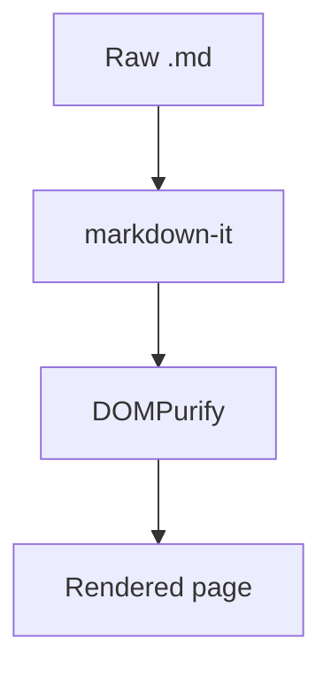

# Kitchen Sink

Every feature in one file. :rocket:

## Text

**Bold**, *italic*, ~~strikethrough~~, `inline code`, H~2~O, x^2^, and a bare link: https://example.com

## Table

| Feature | Status |
| ------- | ------ |
| Tables  | ✅     |
| Math    | ✅     |

## Task list

- [x] Render markdown
- [ ] Take over the world

## Code

```ts
export function greet(name: string): string {
  return `Hello, ${name}!`;
}
```

## Math

Inline $e = mc^2$ and block:

$$
\int_0^\infty e^{-x^2} \, dx = \frac{\sqrt{\pi}}{2}
$$

## Mermaid



## Footnote

Markdown viewers are great.[^1]

[^1]: Citation needed.

## Definition list

Term
: Definition of the term.
